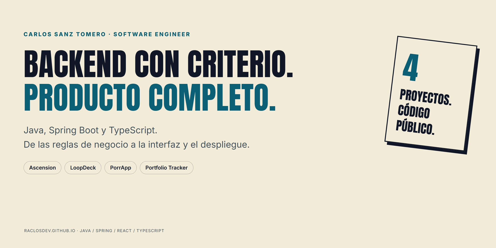
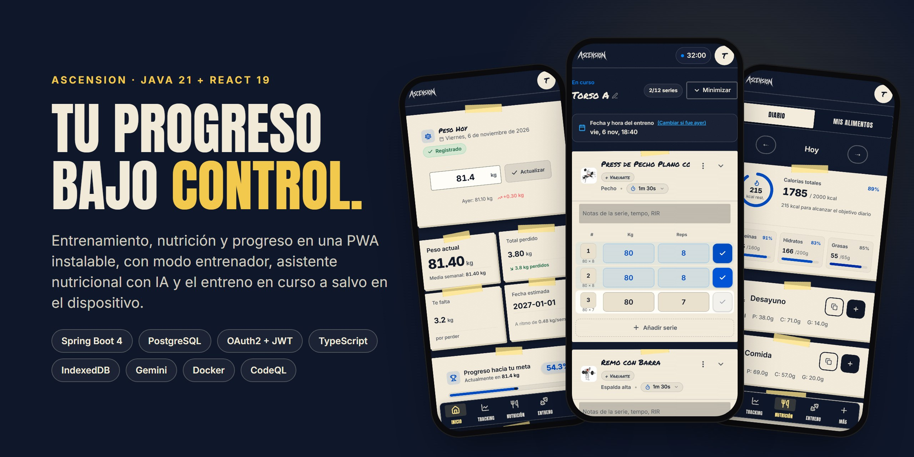
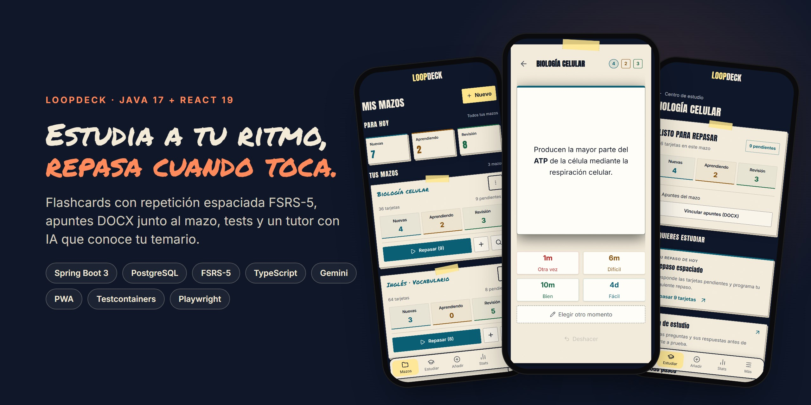
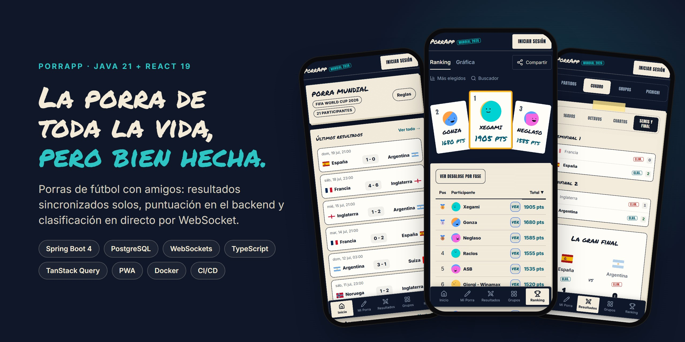

  

    

  
  
  

 

## Lo que he construido

> Tres productos full-stack en producción, desde la idea hasta el despliegue: Java y Spring Boot en el backend, React y TypeScript en el frontend.

 

### Ascension · entrenamiento y nutrición

PWA para registrar entrenos, comidas y progreso. Puedes anotar una comida con una **foto del plato** y Gemini estima calorías y macros. Incluye un **modo entrenador** para pautar programas y nutrición a alumnos, que deciden qué comparten. Por dentro: escrituras idempotentes, límites de uso con *token bucket* en PostgreSQL, temporizadores push con `FOR UPDATE SKIP LOCKED` y el entreno en curso guardado en IndexedDB.

  
  
  
  
  
  
  

**[Abrir la app](https://ascension.raclos.es)** · [Código](https://github.com/RaclosDev/ascension-tracker) · [Arquitectura](https://github.com/RaclosDev/ascension-tracker/blob/main/docs/architecture.md)

 

### LoopDeck · flashcards y repetición espaciada

Plataforma de estudio con repetición espaciada **FSRS-5**, apuntes DOCX junto a cada mazo, tests de cuatro opciones y un **tutor con IA** que responde sobre el contenido del mazo. Gemini también genera tarjetas a partir de listas de términos, siempre desde el backend.

  
  
  
  
  
  
  

**[Abrir la app](https://loopdeck.raclos.es)** · [Código](https://github.com/RaclosDev/loopdeck) · [Arquitectura](https://github.com/RaclosDev/loopdeck/blob/main/docs/ARCHITECTURE.md)

 

### PorrApp · porras de fútbol con amigos

Ligas privadas con tres formatos de porra (cuadro completo, eliminatorias o jornada a jornada). Los resultados se sincronizan solos desde ESPN, la puntuación se calcula en el backend y la clasificación se actualiza **en directo por WebSocket**. El cuadro oficial aplica los desempates FIFA del Mundial 2026, y la puntuación sigue el patrón *Strategy* para admitir torneos nuevos.

  
  
  
  
  
  
  

**[Probar la demo sin registro](https://porrapp.app/demo)** · [Código](https://github.com/RaclosDev/porrApp) · [Arquitectura](https://github.com/RaclosDev/porrApp/blob/main/docs/architecture.md)

 

## Un poco más sobre mí

Soy ingeniero de software con perfil **backend** y experiencia en **Java**, **Spring Boot** y arquitecturas de microservicios. En mi día a día trabajo con transaccionalidad, infraestructura financiera y bots de trading algorítmico de baja latencia.

En mis proyectos personales me gusta tener el control *end-to-end* del producto: diseño la arquitectura, implemento APIs robustas en el backend y desarrollo los frontends en **React**. Así llevo cada aplicación desde la idea hasta producción, con pruebas automatizadas, Docker y CI en GitHub Actions.

   
  
   

