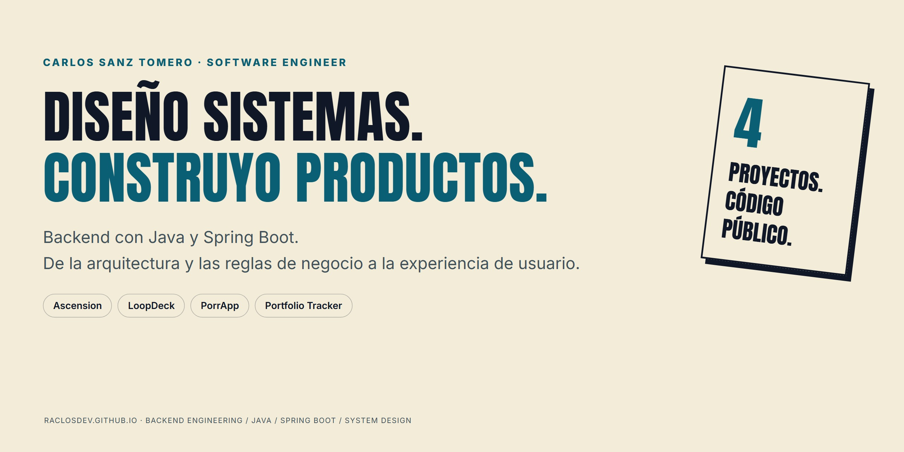
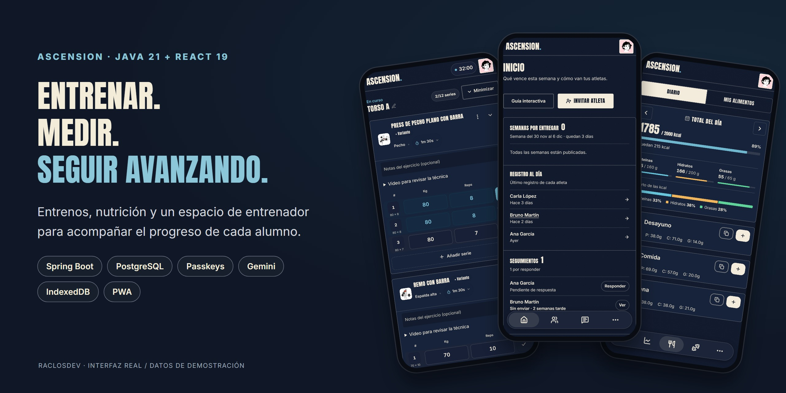
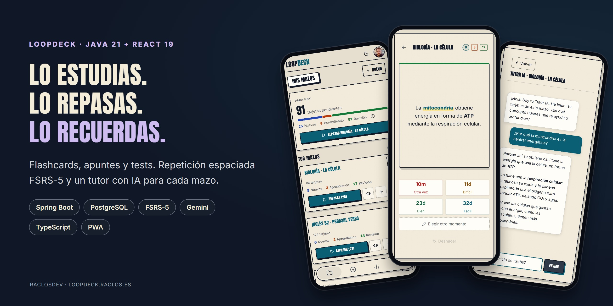
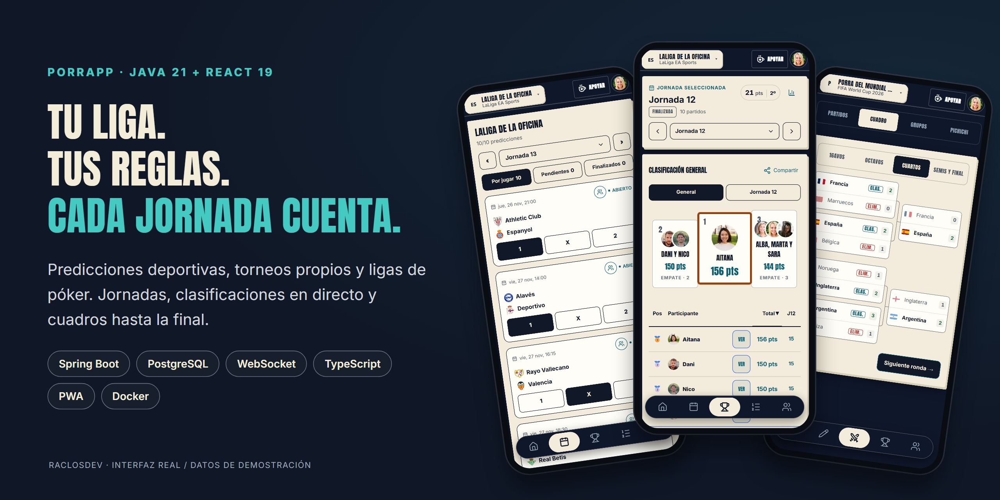
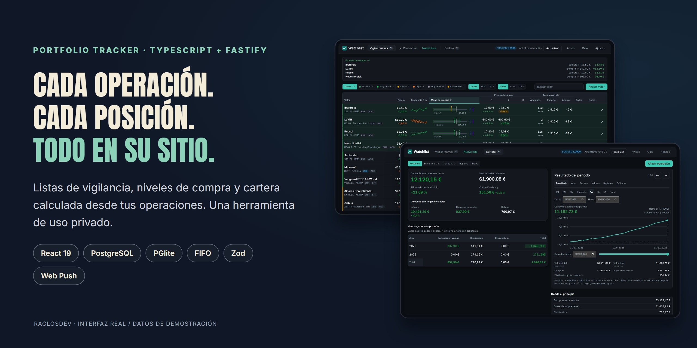

  

  **[Portfolio](https://raclosdev.github.io/)** · **[LinkedIn](https://www.linkedin.com/in/carlos-sanz-tomero/)** · **[Contacto](mailto:raclosdev@gmail.com)**

Soy **Carlos Sanz Tomero**, ingeniero de software con foco en **Java, Spring Boot y backend**. Trabajo con reglas de negocio, transacciones e integraciones; en mis proyectos personales también desarrollo la interfaz y mantengo el despliegue.

Estos cuatro proyectos permiten recorrer el producto y después revisar cómo está construido. Los README incluyen funcionalidades, decisiones técnicas, código relevante y puesta en marcha. Las capturas muestran la interfaz actual con datos de demostración.

## Ascension · entrenamiento, nutrición y seguimiento de atletas

Registro de series, cargas y comidas, con un **espacio de entrenador** para gestionar atletas, seguimientos semanales y planes. Incluye estimación nutricional por foto con Gemini y acceso con Google, correo o passkeys.

**Para revisar en el código:** conservación del entreno en IndexedDB, escrituras idempotentes, permisos entre entrenador y atleta y tareas de notificación coordinadas en PostgreSQL.

`Java 21` · `Spring Boot` · `React 19` · `TypeScript` · `PostgreSQL` · `PWA`

**[Abrir Ascension](https://ascension.raclos.es)** · [Código y recorrido](https://github.com/RaclosDev/ascension-tracker) · [Arquitectura](https://github.com/RaclosDev/ascension-tracker/blob/main/docs/arquitectura.md)

## LoopDeck · estudiar con continuidad

Flashcards con repetición espaciada **FSRS-5**, apuntes DOCX, tests y tutor con IA contextualizado por mazo. El estudio, los apuntes y el repaso comparten un mismo espacio.

**Para revisar en el código:** programación de repasos, intervalos manuales, persistencia del estado de estudio e integración de Gemini desde el servidor.

`Java 21` · `Spring Boot` · `React 19` · `TypeScript` · `PostgreSQL` · `Playwright`

**[Abrir LoopDeck](https://loopdeck.raclos.es)** · [Código y recorrido](https://github.com/RaclosDev/loopdeck) · [Arquitectura](https://github.com/RaclosDev/loopdeck/blob/main/docs/arquitectura.md)

## PorrApp · ligas, predicciones y torneos

Ligas privadas, predicciones deportivas por jornada y competiciones propias. Además del fútbol, contempla otros deportes y esports, **ligas de póker** con reloj de ciegas y estadísticas, y marcadores de juegos de mesa. La demo pública se puede recorrer sin registro.

**Para revisar en el código:** cálculo de puntos en el backend, formatos de competición, cierre de predicciones y actualización del ranking por WebSocket.

`Java 21` · `Spring Boot` · `React 19` · `TypeScript` · `PostgreSQL` · `WebSocket`

**[Probar la demo](https://porrapp.app/demo)** · [Código y recorrido](https://github.com/RaclosDev/porrApp) · [Arquitectura](https://github.com/RaclosDev/porrApp/blob/main/docs/arquitectura.md)

## Portfolio Tracker · de la vigilancia a la cartera

Listas de vigilancia de acciones, ETF y fondos, niveles de compra y una cartera calculada desde compras, ventas, dividendos y traspasos. Incluye buscador por nombre o ISIN, avisos push, importación de Excel, tema oscuro y copias de seguridad. La **demo pública** se recorre sin registro, con una cartera ficticia.

**Para revisar en el código:** cálculo de lotes FIFO separado de la presentación, cadena de proveedores de mercado con caché, copias y restauración de la cartera, y migraciones Flyway probadas con Testcontainers.

`Java 21` · `Spring Boot` · `React 19` · `TypeScript` · `PostgreSQL` · `PWA`

**[Probar la demo](https://cartera.raclos.es/demo)** · [Código y recorrido](https://github.com/RaclosDev/portfolio-tracker) · [Arquitectura](https://github.com/RaclosDev/portfolio-tracker/blob/main/docs/arquitectura.md)

## Cómo trabajo

Parto del problema de uso y llevo las reglas al backend: validación, permisos, transacciones y pruebas. Desarrollo los clientes en React y TypeScript, y mantengo las migraciones, contenedores y comprobaciones de GitHub Actions que necesita cada proyecto.

Mi experiencia profesional está centrada en backend, microservicios e infraestructura financiera. Estos repositorios muestran además mi trabajo de producto: desde el modelo de datos hasta una interfaz que se puede utilizar en el móvil.

[Ver el portfolio completo](https://raclosdev.github.io/) · [Hablemos por LinkedIn](https://www.linkedin.com/in/carlos-sanz-tomero/) · [raclosdev@gmail.com](mailto:raclosdev@gmail.com)
